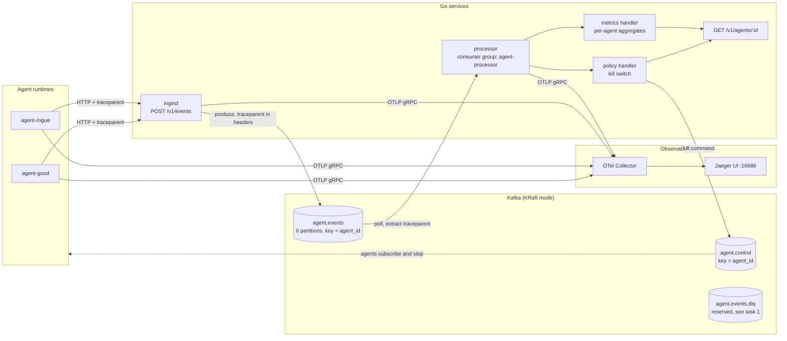

# agent-event-bus

A Go event pipeline for AI agents. Agents report what they do (LLM calls, tool calls, guardrail decisions, errors) to an HTTP ingest service. The service publishes each event to Kafka, keyed by agent. A processor consumes the stream, runs a per-agent kill switch and a metrics aggregator, and publishes a `kill` command when an agent misbehaves. OpenTelemetry context rides in Kafka record headers, so one trace covers the agent, the ingest call, the broker hop, and the kill decision.

Status: v0. Works end to end on a laptop. See [Known limitations](#known-limitations) and [TASKS_FOR_AARON.md](TASKS_FOR_AARON.md) for what is deliberately missing.

## Architecture



One trace from the e2e run, as stored in Jaeger (`span <- parent`):

```
agent.run              <- root                  (simagent)
POST /v1/events        <- agent.run             (ingest, x5)
publish agent.events   <- POST /v1/events       (ingest, x5, PRODUCER)
process agent.events   <- publish agent.events  (processor, x5, CONSUMER)  <- crossed Kafka here
handle policy          <- process agent.events  (processor, x5)
handle metrics         <- process agent.events  (processor, x5)
publish agent.control  <- handle policy         (processor, x1, the kill)
```

## Quick start

Requires Docker with Compose v2. Go 1.26+ only if you want to run tests or binaries on the host.

```sh
make up      # Kafka, OTel Collector, Jaeger, ingest, processor
make demo    # run two simulated agents; prints trace IDs
curl -s localhost:8081/v1/agents/agent-rogue | jq
open http://localhost:16686   # search service "processor"
make down
```

Or run the whole check in one go: `make e2e` (see [scripts/e2e.sh](scripts/e2e.sh)). It fails unless the rogue agent is killed, the kill lands on `agent.control`, the good agent is untouched, and Jaeger has one trace containing spans from `simagent`, `ingest`, and `processor`.

Publish your own event:

```sh
curl -s localhost:8080/v1/events -H 'content-type: application/json' -d '{
  "version": 1, "id": "evt-123", "agent_id": "my-agent", "run_id": "run-1",
  "type": "guard_decision", "ts": "2026-11-11T22:00:00Z",
  "name": "egress-guard", "allowed": false, "reason": "unknown host"
}'
```

## Event schema

| field | required | notes |
|---|---|---|
| `version` | yes | currently `1` |
| `id` | yes | producer-assigned, unique. The future idempotency key (task 3). |
| `agent_id` | yes | Kafka partition key, so each agent's events stay in order |
| `run_id` | no | one task or session |
| `type` | yes | `tool_call`, `llm_call`, `guard_decision`, `error` |
| `ts` | yes | event time; the kill switch windows on this, not wall-clock |
| `name` | no | tool, model, or guard name |
| `duration_ms`, `tokens` | no | non-negative |
| `allowed` | for `guard_decision` | `false` = the guard blocked the action |
| `reason` | no | free text |

Kill switch rules (env vars on the processor, `0` disables a rule): `POLICY_MAX_ERRORS` (default 5), `POLICY_MAX_GUARD_DENIALS` (3), `POLICY_MAX_TOKENS` (200000), all within `POLICY_WINDOW` (1m).

## Why these choices

**Kafka, not a queue (SQS, RabbitMQ) or a database table.** The stream has more than one reader with different needs: the kill switch wants low latency, the aggregator wants everything, and a future audit or replay job wants history. Kafka keeps the log after it is read, so a new consumer group can start from offset 0 and rebuild its own view. Partitioning by `agent_id` gives per-agent ordering, which the kill switch depends on.

**KRaft, no ZooKeeper.** ZooKeeper mode was removed in Kafka 4.0. KRaft runs the metadata quorum inside Kafka, so the local stack is one container instead of two.

**franz-go as the client.** Pure Go (no cgo, unlike confluent-kafka-go), so the binaries build with `CGO_ENABLED=0` into a small Alpine image. It has the idempotent producer on by default and exposes manual commits and rebalance hooks directly.

**At-least-once, commit after processing.** Auto-commit can commit an offset before the handler finishes, which loses events on a crash. Here the processor commits only after every handler succeeds, so a crash causes redelivery, never loss. The cost is duplicates, which task 3 handles.

**Partitions in parallel, records within a partition in order.** Each polled batch is split by partition and each partition runs in its own goroutine. That keeps per-agent order and still uses all cores. Committing the last successful record per partition commits everything before it.

**Event time for the kill switch.** Windows use the event's `ts`, so replaying a partition produces the same decisions. With wall-clock time, a replay after an outage would see an hour of events land in one second and kill everyone.

**A `bus` interface with an in-memory broker.** The processor logic (commit-after-success, redelivery, per-partition order, trace propagation) is tested in milliseconds without Docker. The in-memory broker models committed offsets per group, so a "restart" in a test is just a new consumer on the same group.

**Hand-written header carrier instead of an instrumentation plugin.** It is about 30 lines (`internal/tracing/carrier.go`), and it is the part worth understanding: inject on produce, extract on consume, start a CONSUMER span whose parent is the PRODUCER span.

**OTel Collector between services and Jaeger.** Services only speak OTLP. Switching to Tempo, Honeycomb, or Datadog is a collector config change, not a code change.

**HTTP ingest in front of Kafka.** Agent runtimes are Python, TypeScript, and whatever comes next. A POST is easier to add to all of them than a Kafka client, and it keeps broker credentials and schema validation in one place.

## Delivery semantics

| hop | guarantee | how |
|---|---|---|
| agent -> ingest | at-least-once if the agent retries on non-202 | 202 is returned only after Kafka acks |
| ingest -> Kafka | no duplicates from producer retries, per partition | franz-go idempotent producer, `acks=all` |
| Kafka -> processor | at-least-once | manual commit after handlers succeed |
| processor side effects | duplicates possible | task 3 adds dedupe by `id` |

## Known limitations

These are real and intentional for v0.

1. **Processor state is in memory.** Restarting the processor clears kill-switch state and aggregates, and it resumes from the committed offset, so it does not rebuild them. Verified: after `docker compose restart processor`, `GET /v1/agents/agent-rogue` returns 404. The kill command already on `agent.control` is durable, so agents that consumed it stay stopped. Fixing this properly ties into task 2.
2. **No dead-letter queue.** Invalid records are logged and skipped. A handler error stops the processor so the record is redelivered after restart, which blocks that partition if the error is permanent. Task 1.
3. **Rebalances are not handled gracefully.** Safe (no loss) but noisy (redelivery). Task 2.
4. **Not idempotent.** A redelivered event is counted twice. Task 3.
5. **No auth on either HTTP API, single-broker Kafka, replication factor 1.** Local dev only.

## Layout

```
cmd/
  ingest/       HTTP -> Kafka
  processor/    Kafka -> policy + metrics, read API on :8081
  simagent/     two fake agents for demos
internal/
  event/        schema + validation
  bus/          Producer/Consumer interfaces, franz-go impl, in-memory broker
  tracing/      OTel setup, Kafka header carrier, traced producer
  policy/       kill switch (sliding window, event time, sticky)
  metrics/      per-agent aggregates
  processor/    poll -> handle -> commit loop, handlers, read API
  ingest/       HTTP handler
deploy/otel-collector.yaml
docker-compose.yml
scripts/e2e.sh
```

## Tests

```sh
go test ./...                # unit + in-memory pipeline tests, no Docker
go test -race -count=1 ./... # same, with the race detector
make e2e                     # real Kafka, collector, Jaeger
```

`TestRedeliveryIsIdempotent` is skipped on purpose; it is the acceptance test for task 3.
